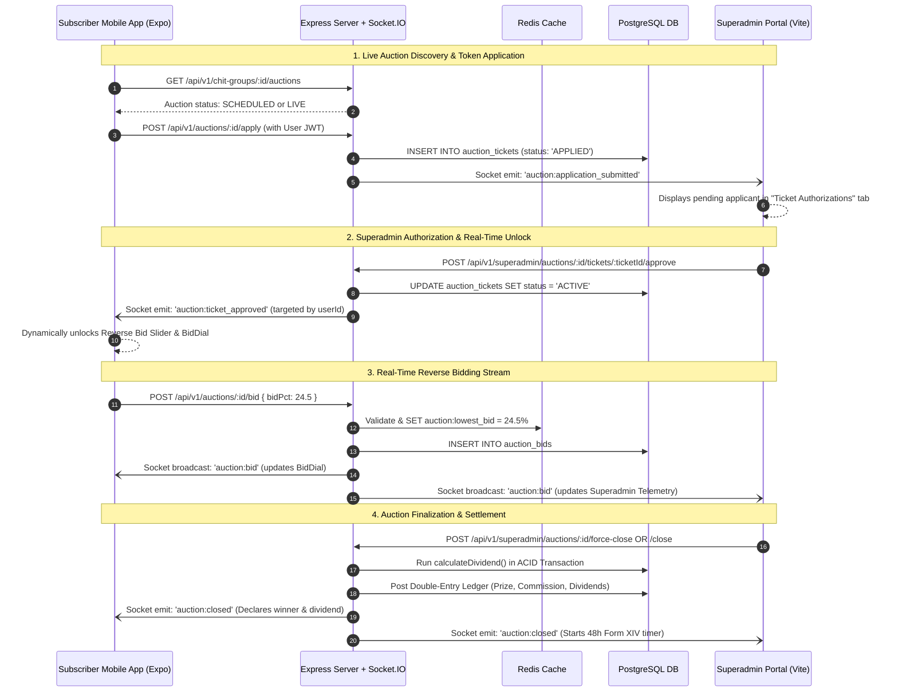
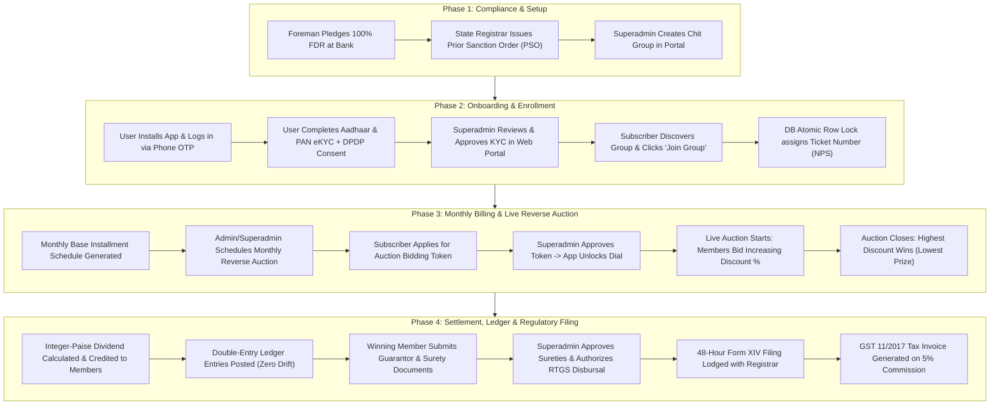
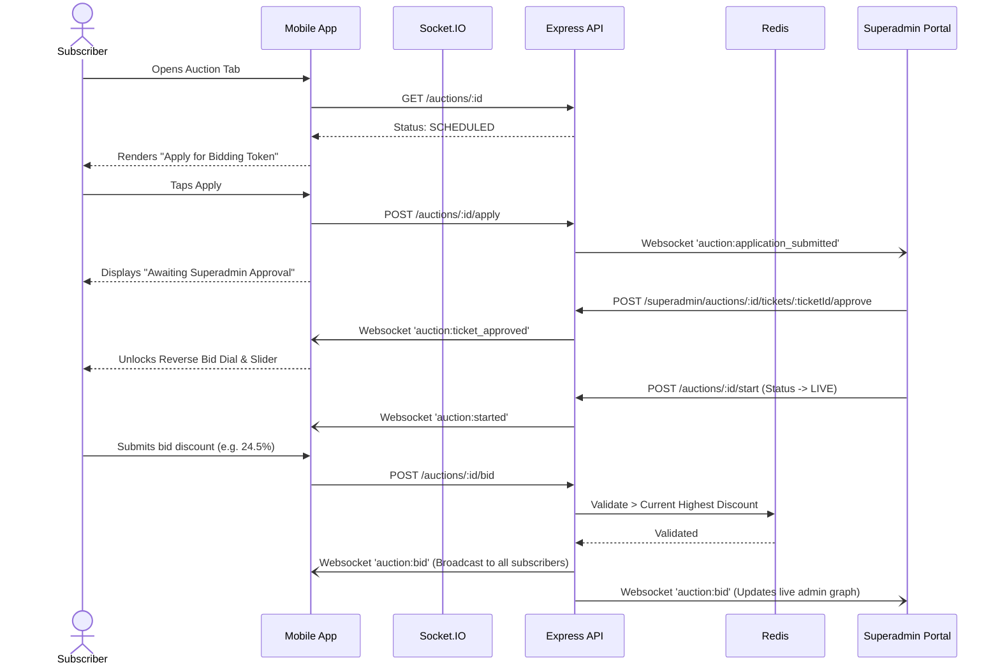

# Naveen Chit Fund — End-to-End Workflow, Architecture & Business Rules Manual

---

## 1. Executive Summary & Domain Fundamentals

**Naveen Chit Fund** is a digital, institutional-grade Rotating Savings and Credit Association (ROSCA) management platform. It digitizes the entire lifecycle of registered Indian chit funds under the statutory mandate of:
* **The Chit Funds Act, 1982** (and 2019 Central Amendments).
* **The Digital Personal Data Protection (DPDP) Act, 2023** (Sections 5, 6, and 11 consent and data subject rights).
* **Government of India GST Notification No. 11/2017 - Central Tax (Rate)** (18% GST exclusively on Foreman Commission).
* State Chit Registrar systems (e.g., Telangana *T-Chits* and Andhra Pradesh Registrar of Chits).

---

## 2. Core Chit Fund Business Rules & Mathematical Formulas

A chit fund operates simultaneously as a disciplined monthly savings vehicle and a collateralized credit facility.

### 2.1 The Core Equations

| Metric | Symbol | Definition & Formula | Example (₹5,00,000 / 20 Months) |
|---|:---:|---|---|
| **Chit Value** | $C$ | Aggregate value of the chit group pool. | ₹5,00,000 |
| **Tenure / Members** | $N$ | Number of months and total participating tickets. | 20 members / 20 months |
| **Base Monthly Installment** | $M$ | Base installment before dividend offset: $M = \frac{C}{N}$ | ₹25,000 / month |
| **Auction Bid Discount** | $D$ | Percentage or sum surrendered by bidder: $D_{\text{val}} = \text{round}\left(\frac{C \times D_{\%}}{100}\right)$ | If bid is 25%: ₹1,25,000 |
| **Foreman Commission** | $F$ | Capped at **5.00%** of chit value by § 21 of the Act: $F = 5\% \times C$ | ₹25,000 |
| **Net Prize Money** | $P$ | Amount disbursed to the successful bidder: $P = C - D_{\text{val}}$ | ₹5,00,000 - ₹1,25,000 = **₹3,75,000** |
| **Distributable Dividend** | $\Delta$ | Surplus discount returned to members: $\Delta = D_{\text{val}} - F$ | ₹1,25,000 - ₹25,000 = **₹1,00,000** |
| **Per-Subscriber Dividend** | $d_i$ | Member share reducing next installment: $d_i = \lfloor \frac{\Delta}{N_{\text{eligible}}} \rfloor$ | ₹1,00,000 / 19 = **₹5,263** |
| **Net Monthly Installment Due** | $I_{\text{due}}$ | Actual installment payable: $I_{\text{due}} = M - d_i$ | ₹25,000 - ₹5,263 = **₹19,737** |

---

### 2.2 Statutory Guardrails & Operating Rules

> [!IMPORTANT]
> The platform enforces non-negotiable statutory guardrails in both API validations and database constraints.

1. **Bid Discount Ceiling (Statutory Cap)**:
   * **Rule**: Under § 14 of the Chit Funds Act, 1982, the maximum discount bid in an auction cannot exceed **40%** (or state-specified cap, e.g. 25% or 30%).
   * **Purpose**: Prevents financially desperate subscribers from taking predatory discounts that cause loan repayment defaults.
2. **Bid Floor**:
   * **Rule**: The discount bid cannot be lower than the Foreman Commission (**5%**).
3. **Integer-Paise Precision Arithmetic**:
   * **Rule**: Floating-point math (`0.1 + 0.2 != 0.3`) is strictly forbidden across the backend ledger and dividend engine.
   * **Implementation**: All values are converted to **integer paise** ($1 \text{ INR} = 100 \text{ paise}$).
   * **Remainder Distribution**: If $\Delta_{\text{paise}} \pmod N \neq 0$, the remaining paise are deterministically credited to the last subscriber ticket in the group roster. **Zero paise are created or lost.**
4. **100% Fixed Deposit Receipt (FDR) Pledge**:
   * Before soliciting any subscriber for a new chit series, the Foreman must deposit 100% of the aggregate chit value ($C$) in a scheduled commercial bank and pledge the FDR with the State Registrar to obtain a **Prior Sanction Order (PSO)**.
5. **Subscriber Roles & State Transitions**:
   * **NPS (Non-Prized Subscriber)**: Has not yet won an auction. Eligible to bid and earns monthly dividends.
   * **SB (Successful Bidder)**: Has won the current auction. Enters surety vetting; cannot place further bids.
   * **PS (Prized Subscriber)**: Sureties approved and prize money disbursed. Must continue paying base monthly installments until group maturity, with no future bidding rights.
6. **Grace Periods & Overdue Arrears**:
   * Under § 22 of the Act, a 7-day grace period is granted following the monthly installment due date.
   * If unpaid after 7 days, a statutory interest penalty of **1.5% per month** accrues, and the subscriber is disqualified from bidding until arrears are settled.

---

## 3. High-Level Architecture & Connectivity

The platform is divided into three primary tiers:
1. **Subscriber Mobile & Web App** (`frontend/`): Built with React Native and Expo (SDK 57) for iOS, Android, and responsive web.
2. **Superadmin Governance Portal** (`superadmin-web/`): Built with React 18, Vite, Tailwind CSS, and TanStack Query for executive compliance and administration.
3. **Backend API Gateway & Real-Time Engine** (`backend/`): Built with Node.js, Express, Socket.IO, PostgreSQL (ACID relational store), and Redis (in-memory low-latency auction stream).

```
┌────────────────────────────────────────────────────────┐  ┌────────────────────────────────────────────────────────┐
│               SUBSCRIBER MOBILE APP                    │  │              SUPERADMIN WEB PORTAL                     │
│            React Native / Expo (SDK 57)                │  │              React 18 + Vite + Tailwind                │
│    • Bottom Tabs: Home, Chits, Live Auction, Profile   │  │    • Operations Desk: Groups, KYC Queue, Sureties      │
│    • Real-time BidDial, Slider & Ticket Status         │  │    • Compliance Engine: Form XIV, GST, DPDP Exporter   │
│    • Auth: Phone + SMS OTP (JWT User Scope)            │  │    • Auth: Email + Pass (JWT Superadmin Scope)         │
└───────────────────────────┬────────────────────────────┘  └───────────────────────────┬────────────────────────────┘
                            │                                                           │
                   REST & Socket.IO                                            REST & Socket.IO
                 (Bearer JWT 'user')                                         (Bearer JWT 'superadmin')
                            │                                                           │
                            ▼                                                           ▼
┌────────────────────────────────────────────────────────────────────────────────────────────────────────────────────┐
│                                             EXPRESS API GATEWAY (Port 4000)                                        │
│  ├── Security: Helmet, CORS, Rate Limiters, Morgan Logging, Zod Validation Schemas                                 │
│  ├── Authentication & Scope Firewall: isolates /api/v1/superadmin/* from /api/v1/*                                 │
│  ├── Socket.IO Server: Room-isolated real-time auction event pub/sub                                               │
│  └── Ledger & Dividend Engine: Integer-paise double-entry accounting engine                                        │
└─────────────────────────────────────┬──────────────────────────────────────────┬───────────────────────────────────┘
                                      │                                          │
                                      ▼                                          ▼
┌────────────────────────────────────────────────────────┐  ┌────────────────────────────────────────────────────────┐
│                  POSTGRESQL DATABASE                   │  │                 REDIS / IN-MEMORY CACHE                │
│  • PGCrypto UUID primary keys                          │  │  • Real-time lowest auction bid cache                  │
│  • Concurrency row-locking (FOR UPDATE)                │  │  • High-frequency bid deduplication (< 5ms response)   │
│  • Double-entry immutable ledger tables                │  │  • Dynamic auction timer countdowns                     │
│  • Subscriber KYC, Groups, Subscriptions, Payments     │  │  • Fallback in-memory store if Redis server is offline │
└────────────────────────────────────────────────────────┘  └────────────────────────────────────────────────────────┘
```

---

## 4. How the Mobile App and Web Portal Are Connected

The mobile app and the superadmin portal operate over a shared backend while maintaining strict security separation:



### Key Connection Touchpoints

| Flow Touchpoint | Mobile App Action | Backend Processing | Superadmin Web Action |
|---|---|---|---|
| **KYC Verification** | User uploads PAN/Aadhaar photos (`PATCH /api/v1/users/me`) | Saves documents, marks user status as `PENDING` | Reviews documents in KYC Queue, clicks **Approve** or **Reject** with reason code |
| **Auction Participation** | Clicks **Apply for Auction Token** (`POST /api/v1/auctions/:id/apply`) | Logs ticket in `APPLIED` status, emits websocket event | Sees applicant badge in real time, clicks **Approve Access** |
| **Live Bidding** | Spins `BidDial` or drags slider to place bid discount % | Validates eligibility, updates Redis lowest bid, inserts audit record | Monitors live bid feed in telemetry deck; can trigger emergency **Force-Close** |
| **Surety & Disbursal** | Winning subscriber submits salary slips and 2 guarantor PANs | Stores surety dossier under subscription | Verifies documents, reviews net payout ($C - D$), triggers simulated **RTGS Payout** |
| **Installment Payments** | Pays via Razorpay UPI/Netbanking (`POST /api/v1/payments/order`) | Verifies HMAC SHA-256 webhook, updates ledger | Views real-time collection metrics, overdue arrears, and cash flow on Dashboard |

---

## 5. End-to-End Operational Lifecycle Workflows



---

### Workflow 1: User Onboarding & DPDP Consent

1. **Authentication**:
   * Subscriber inputs a 10-digit Indian phone number on the mobile app.
   * Backend generates a cryptographically secure 6-digit OTP stored in `otp_codes` with a 5-minute TTL.
   * Subscriber enters OTP. Backend verifies code, issues a signed JWT (`role = 'user'`), and creates a record in `users`.
2. **DPDP 2023 Statutory Consent**:
   * The app presents the mandatory 5-category consent form before enabling financial activity:
     1. Identity Verification (UIDAI / DigiLocker XML).
     2. Credit Bureau Check (CIBIL / Experian inquiry).
     3. Auction Participation Records.
     4. Financial Intelligence Reporting (PMLA / FIU-IND).
     5. Marketing Communications (optional opt-in).
3. **eKYC Submission & Review**:
   * Subscriber inputs legal name, PAN number, and uploads identity documents.
   * Superadmin accesses `http://localhost:5174/chit/kyc` to inspect document authenticity.
   * When approved, subscriber status becomes `VERIFIED`, unlocking group enrollments and bidding.

---

### Workflow 2: Group Creation & Atomic Ticket Allocation

1. **Creation**:
   * The Superadmin registers a new group specifying: Chit Value (e.g. ₹5,00,000), Duration (20 months), Maximum Bid Ceiling (e.g. 40%), Foreman Commission (5%), and Registrar PSO number.
2. **Atomic Seat Allocation**:
   * When a subscriber taps **Join Group**, the backend initiates a transaction with row-level locking:
     ```sql
     SELECT * FROM chit_groups WHERE id = $1 FOR UPDATE;
     ```
   * It checks whether vacant slots remain. If available, it allocates:
     ```sql
     ticket_number = COALESCE(MAX(ticket_number), 0) + 1
     ```
   * An initial subscription record is saved with status `NPS` (Non-Prized Subscriber), and $N$ pending monthly installment records are initialized.

---

### Workflow 3: Auction Token Application & Live Reverse Auction



1. **Token Discovery & Application**:
   * When an auction is `SCHEDULED` or `LIVE`, subscribers must hold an active token to place bids.
   * Subscribers submit a token application via `POST /api/v1/auctions/:id/apply`.
   * Status transitions to `APPLIED`.
2. **Superadmin Verification**:
   * The Superadmin reviews applicant installment payment history and KYC status on the Superadmin Portal.
   * Clicking **Approve Access** updates ticket status to `ACTIVE` and pushes the WebSocket event `auction:ticket_approved`.
3. **Dynamic Unlock**:
   * The mobile app receives the socket event and automatically switches the screen from the waiting state to the interactive circular `BidDial` and `ReverseBidSlider`.
4. **Live Bidding Dynamics**:
   * Bids are submitted as **Discount Percentages** (e.g., 20.0%, 20.5%, 21.0%).
   * Higher discount = lower prize money taken = larger dividend distributed to fellow subscribers.
   * Incoming bids are written to Redis for sub-5ms broadcast and asynchronously logged to PostgreSQL for audit inspection.

---

### Workflow 4: Auction Finalization & Integer-Paise Dividend Engine

1. **Closing**:
   * At auction conclusion or via Superadmin **Force-Close**, the winning subscriber (highest discount bid) is finalized.
2. **Dividend Engine Calculation**:
   $$\text{Chit Value} = ₹5,00,000.00 \implies 50,000,000 \text{ paise}$$
   $$\text{Winning Bid (25\%)} = 12,500,000 \text{ paise}$$
   $$\text{Foreman Commission (5\%)} = 2,500,000 \text{ paise}$$
   $$\text{Distributable Pool} = 12,500,000 - 2,500,000 = 10,000,000 \text{ paise (₹1,00,000)}$$
   $$\text{Per-Member Dividend (19 NPS)} = \lfloor \frac{10,000,000}{19} \rfloor = 526,315 \text{ paise (₹5,263.15)}$$
   $$\text{Remainder} = 10,000,000 \pmod{19} = 15 \text{ paise}$$
   * The last eligible subscriber receives $526,315 + 15 = 526,330 \text{ paise}$, ensuring the entire ₹1,00,000 pool is distributed to the exact paisa.
3. **Double-Entry Ledger Postings**:
   Within a single database transaction, the following ledger records are written:
   * `PRIZE_PAYOUT`: Credit to winning subscriber's prize liability account.
   * `COMMISSION`: Credit to Foreman operating revenue account.
   * `DIVIDEND`: Credits to each non-prized subscriber's ledger, reducing their next installment payable.

---

### Workflow 5: Surety Approval, RTGS Disbursal & Compliance Filing

1. **Surety Dossier**:
   * The winning subscriber submits security documents:
     * Option A: 2 salaried or business co-guarantors (PAN, address proof, pay slips).
     * Option B: Bank Fixed Deposit Receipt or immovable property title deeds.
2. **Superadmin Verification**:
   * Superadmin reviews surety documents under **Sureties Management**.
   * Approves the release of funds:
     $$\text{Net Disbursal} = \text{Gross Chit} - \text{Bid Discount} - \text{Existing Arrears}$$
   * System records the Bank UTR / RTGS reference number and changes subscriber status from `SB` to `PS`.
3. **Form XIV Statutory Minutes Filing**:
   * Within **48 hours** of auction completion, the Superadmin portal generates the statutory Form XIV PDF.
   * Portal displays a 48-hour countdown timer (`GREEN` < 24h, `AMBER` 24–36h, `RED` 36–48h) to prevent statutory default under § 17 of the Act.
4. **GST Tax Invoicing**:
   * System issues a GST-compliant invoice levying **18% GST exclusively on the 5% Foreman Commission** (SAC Code 9971).
   * E.g., on a ₹25,000 commission, GST liability is ₹4,500 (₹2,250 CGST + ₹2,250 SGST).

---

## 6. Security, Isolation & Audit Framework

```
                          SECURITY BOUNDARY ARCHITECTURE
 ┌──────────────────────────────────────┐  ┌──────────────────────────────────────┐
 │         SUBSCRIBER MOBILE APP        │  │       SUPERADMIN WEB CONSOLE         │
 │  • Token: JWT (aud: 'subscriber')    │  │  • Token: JWT (aud: 'superadmin')    │
 │  • Storage: expo-secure-store        │  │  • Storage: httpOnly/Secure cookie   │
 │  • Limit: 100 req/min                │  │  • Limit: 30 req/min (Strict)        │
 └──────────────────┬───────────────────┘  └──────────────────┬───────────────────┘
                    │                                         │
                    ▼                                         ▼
 ┌──────────────────────────────────────┐  ┌──────────────────────────────────────┐
 │     SUBSCRIBER ROUTES (/api/v1/*)    │  │ SUPERADMIN ROUTES (/superadmin/*)    │
 │  • RBAC Guard: role === 'user'       │  │  • RBAC Guard: role === 'superadmin' │
 │  • Validates Subscriber Ticket State │  │  • Constant-time auth checks         │
 │  • Rate-limited auction bids         │  │  • Account lock after 5 bad attempts │
 └──────────────────┬───────────────────┘  └──────────────────┬───────────────────┘
                    │                                         │
                    └───────────────────┬─────────────────────┘
                                        ▼
 ┌────────────────────────────────────────────────────────────────────────────────┐
 │                      IMMUTABLE AUDIT LOGGING ENGINE                            │
 │  All state mutations (KYC approval, force close, RTGS release) write to        │
 │  'audit_events' table: { actor_id, actor_type, action, ip, diff_snapshot }     │
 └────────────────────────────────────────────────────────────────────────────────┘
```

1. **Audience & Secret Isolation**:
   * Regular subscriber tokens cannot access `/api/v1/superadmin/*` endpoints.
   * Superadmin tokens are signed with a distinct secret (`SUPERADMIN_JWT_SECRET`) with `aud: 'superadmin'`.
2. **Account Lockout Protection**:
   * Superadmin login enforces an automatic 15-minute account lock after 5 consecutive failed login attempts.
3. **Double-Entry Ledger Immutability**:
   * Ledger entries are append-only. No `UPDATE` or `DELETE` operations are permitted on `ledger_entries`. Corrections require adjusting journal entries.
4. **DPDP Section 11 Data Portability**:
   * Subscribers can request full export of their personal data. The Superadmin portal provides a one-click export generating a complete, timestamped JSON bundle of all profile information, payment records, bids, and signed consent receipts.

---

## 7. Complete API & WebSocket Event Matrix

### 7.1 Core REST Endpoints

| Category | Method | Path | Auth Scope | Function |
|---|:---:|---|:---:|---|
| **Auth** | `POST` | `/api/v1/auth/otp/request` | Public | Sends 6-digit SMS OTP |
| | `POST` | `/api/v1/auth/otp/verify` | Public | Verifies OTP; returns JWT bearer token |
| **Profile** | `GET` | `/api/v1/users/me` | User | Fetches user profile, KYC status, and tickets |
| | `PATCH` | `/api/v1/users/me` | User | Submits PAN and KYC details for verification |
| **Chits** | `GET` | `/api/v1/chit-groups` | Public | Lists active and open chit groups |
| | `POST` | `/api/v1/chit-groups/:id/join` | User | Atomically joins chit group and allocates ticket |
| **Auctions** | `GET` | `/api/v1/auctions/:id` | Public | Fetches auction details and live Redis state |
| | `POST` | `/api/v1/auctions/:id/apply` | User | Submits application for auction bidding token |
| | `POST` | `/api/v1/auctions/:id/bid` | User | Places reverse bid discount percentage |
| **Payments** | `POST` | `/api/v1/payments/order` | User | Creates Razorpay payment order for installment |
| | `POST` | `/api/v1/payments/webhook` | Raw Signature | Receives and verifies payment capture webhooks |
| **Superadmin** | `POST` | `/api/v1/superadmin/auth/login` | Public | Superadmin credentials login |
| | `GET` | `/api/v1/superadmin/dashboard/stats` | Superadmin | Returns aggregate AUM, delinquencies, and KPIs |
| | `POST` | `/api/v1/superadmin/kyc/:id/review` | Superadmin | Approves or rejects subscriber KYC document |
| | `POST` | `/api/v1/superadmin/auctions/:id/tickets/:ticketId/approve` | Superadmin | Authorizes bidding token for auction entry |
| | `POST` | `/api/v1/superadmin/auctions/:id/force-close` | Superadmin | Emergency terminates auction and declares winner |
| | `POST` | `/api/v1/superadmin/sureties/:id/decision` | Superadmin | Approves surety and authorizes RTGS fund release |
| | `GET` | `/api/v1/superadmin/compliance/form-xiv/:id` | Superadmin | Generates and downloads Form XIV minutes PDF |

### 7.2 WebSocket (Socket.IO) Events

| Event Name | Direction | Payload | Description |
|---|:---:|---|---|
| `joinAuction` | Client $\rightarrow$ Server | `{ auctionId }` | Subscribes socket to room `auction:<auctionId>` |
| `auction:application_submitted` | Server $\rightarrow$ Admin | `{ auctionId, userId, ticketNumber }` | Alerts Superadmin of new token applicant |
| `auction:ticket_approved` | Server $\rightarrow$ Client | `{ auctionId, userId, ticketCode }` | Unlocks live bidding dial on mobile app |
| `auction:started` | Server $\rightarrow$ All | `{ auctionId, startedAt }` | Signals auction room has moved to LIVE |
| `auction:bid` | Server $\rightarrow$ All | `{ bidPct, ticketNumber, bidAt }` | Broadcasts new lowest prize / highest discount bid |
| `auction:closed` | Server $\rightarrow$ All | `{ winningBidPct, winningTicketNumber, netPrize }` | Concludes auction and displays final breakdown |

---

## 8. Summary Checklist for Running the System

```bash
# 1. Start Backend API & Real-Time Engine (Port 4000)
cd backend
npm run dev

# 2. Start Superadmin Governance Web Portal (Port 5174)
cd superadmin-web
npm run dev

# 3. Start Subscriber Mobile App (Port 8081)
cd frontend
npm run web      # For browser preview
npm run android  # For Android emulator / device
```

* **Superadmin Web Access**: `http://localhost:5174/chit` (Login: `admin@naveenchit.com` / `12345678`).
* **Seeded Subscriber Accounts**: Phone numbers `+919999900001` through `+919999900005` (OTP logged to backend console).

